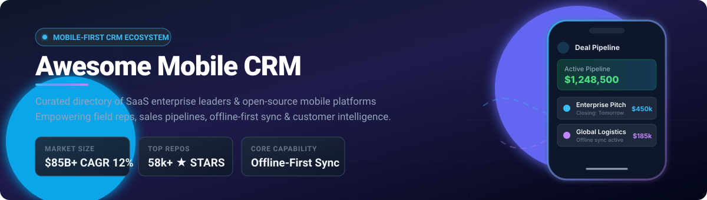

  

# 📱 Awesome Mobile CRM App Ecosystem 🚀

**A Curated Directory of SaaS Enterprise Platforms & Open-Source Mobile CRM Projects**  
*Empowering Field Sales Enablement, Offline-First Architecture, Contact Management & Customer Intelligence On The Go*

---

## 📑 Table of Contents
- [🌐 Sector Overview & Market Dynamics](#-sector-overview--market-dynamics)
- [🏢 SaaS & Hosted CRM Platforms](#-saas--hosted-crm-platforms)
- [🔓 Open-Source GitHub Projects](#-open-source-github-projects)
- [🛠️ Frameworks & Architecture Stack](#️-frameworks--architecture-stack)
- [🤝 How to Contribute](#-how-to-contribute)
- [⭐ Star History](#-star-history)
- [💖 Support & Sponsorship](#-support--sponsorship)
- [📜 Disclaimer](#-disclaimer)

---

## 🌐 Sector Overview & Market Dynamics

The global Mobile CRM market is projected to expand from **~$85 billion in 2024–2025 to over $140 billion by 2030 (CAGR of ~12.5%)**, propelled by mobile-first field sales reps, hybrid distributed workforces, and on-device AI assistants. The market exhibits **moderate fragmentation with a concentrated upper tier**: while multi-billion-dollar enterprise giants (Salesforce, Microsoft, HubSpot) dominate large enterprise accounts, agile mid-market challengers (Pipedrive, Close, Freshworks) and self-hosted open-source platforms (Twenty, Odoo, EspoCRM) capture substantial share among privacy-conscious, developer-first, and SMB segments.

---

## 🏢 SaaS & Hosted CRM Platforms

The table below lists leading commercial Mobile CRM solutions, ranked by corporate scale (estimated revenue / market capitalization) descending:

| 🏆 Product | 💰 Starting Pricing | 🎁 Free Tier Limit / Trial Duration | 🏢 Company Scale (Revenue / Valuation) | 📱 Key Mobile Capabilities |
| :--- | :--- | :--- | :--- | :--- |
| **[Microsoft Dynamics 365 Mobile](https://www.microsoft.com/en-us/dynamics-365)** | $65/user/month (Dynamics 365 Sales Professional) | 30-day free trial with full sales feature access (no permanent free tier) | **~$3.1 Trillion market cap** (~$245B annual revenue) | Enterprise CRM mobile app with offline synchronization, Microsoft Power Apps extensibility, and AI Copilot guidance. |
| **[Salesforce Mobile App](https://www.salesforce.com/)** | $25/user/month (Starter Suite, billed annually) | 30-day free trial with sample enterprise data (no permanent free tier) | **~$280 Billion market cap** (~$35B annual revenue) | Native iOS/Android app with offline record caching, voice notes, business card scanner, and Einstein AI field intelligence. |
| **[HubSpot Mobile App](https://www.hubspot.com/)** | $15/seat/month (Sales Hub Starter, billed annually) | Free-forever tier (up to 2,500 contacts, core CRM, contact & deal pipelines, 1 shared inbox) | **~$32 Billion market cap** (~$2.2B annual revenue) | Full pipeline management, integrated mobile calling with automatic call recording, and instant deal notifications. |
| **[Zendesk Sell Mobile](https://www.zendesk.com/sell/)** | $19/agent/month (Sell Team tier, billed annually) | 14-day free trial with full feature access (no permanent free tier) | **~$10.2 Billion valuation** (Acquired by Hellman & Friedman, ~$1.7B revenue) | Geolocation mapping to visualize nearby clients, offline access with auto-sync, and one-tap call/text logging. |
| **[Zoho CRM Mobile](https://www.zoho.com/crm/)** | $14/user/month (Standard tier, billed annually) | Free-forever tier for up to 3 users (leads, documents, contacts, basic reports); 15-day trial on paid tiers | **~$1.2 Billion+ annual revenue** (Bootstrapped, estimated $10B+ valuation) | Full offline sync, Zia AI voice assistant, GPS check-in/checkout at customer sites, and business card scanning. |
| **[Freshsales Mobile](https://www.freshworks.com/freshsales-crm/)** | $9/user/month (Growth tier, billed annually) | Free-forever tier for up to 3 users (built-in chat, email, contact management); 21-day free trial on paid tiers | **~$4.5 Billion market cap** (~$700M annual revenue) | AI-powered contact scoring (Freddy AI), in-app VoIP calling, SMS tracking, and mobile meeting check-ins. |
| **[Pipedrive Mobile](https://www.pipedrive.com/)** | $14/user/month (Lite tier, billed annually) | 14-day free trial with full access to pipelines and features (no permanent free tier) | **~$1.5 Billion valuation** (Acquired by Vista Equity Partners, ~$250M ARR) | Visual Kanban deals pipeline, automated call logging, audio notes, and agenda view for upcoming sales appointments. |
| **[SugarCRM Mobile](https://www.sugarcrm.com/)** | $19/user/month (Sugar Sell Essentials tier, billed annually) | 7-day free trial with full module access (no permanent free tier) | **~$150 Million+ ARR** (Backed by Accel-KKR, estimated $1B valuation) | Native mobile suite, custom modules, geocoding for field visits, and robust offline data sync engine. |
| **[Copper Mobile](https://www.copper.com/)** | $9/user/month (Starter tier, billed annually) | 14-day free trial with Google Workspace integration (no permanent free tier) | **~$50 Million+ ARR** (Private equity-backed, estimated $300M valuation) | Deep Google Workspace integration, native Gmail/Calendar sync, mobile pipeline alerts, and relationship tracking. |
| **[Close Mobile](https://close.com/)** | $49/month (Solo plan for 1 user, billed annually) | 14-day free trial with complete calling, SMS, and pipeline tooling (no permanent free tier) | **~$25 Million+ ARR** (Bootstrapped / privately held, estimated $150M valuation) | Dedicated sales-focused client with integrated mobile VoIP dialer, 2-way SMS, email tracking, and deal stages. |

---

## 🔓 Open-Source GitHub Projects

Discover top self-hosted, customizable, and community-driven mobile CRM applications. Repositories are ranked by their **GitHub_Stars_Count** descending:

| 💻 Repository | 🌟 GitHub_Stars | 📜 License | 💡 Overview & Mobile Capabilities |
| :--- | :---: | :---: | :--- |
| **[twentyhq/twenty](https://github.com/twentyhq/twenty)** |  | AGPL-3.0 | Modern open-source CRM alternative to Salesforce with GraphQL APIs, offline caching, and native cross-platform mobile companions. |
| **[odoo/odoo](https://github.com/odoo/odoo)** |  | LGPL-3.0 | Comprehensive enterprise ERP/CRM suite with official Android and iOS apps supporting offline access, barcode/business card scanning, and push alerts. |
| **[krayin/laravel-crm](https://github.com/krayin/laravel-crm)** |  | MIT | Lightweight Laravel-powered open-source CRM with mobile-first PWA responsiveness and REST APIs for custom native clients. |
| **[salesagility/SuiteCRM](https://github.com/salesagility/SuiteCRM)** |  | AGPL-3.0 | Enterprise-grade open-source CRM with community iOS/Android mobile clients, offline record queues, and REST API v11+ sync. |
| **[frappe/crm](https://github.com/frappe/crm)** |  | AGPL-3.0 | Next-gen CRM built on Frappe Framework with mobile PWA and native app support, lead pipeline management, and call integration. |
| **[espocrm/espocrm](https://github.com/espocrm/espocrm)** |  | AGPL-3.0 | Clean, fast CRM with official native iOS client, mobile push notifications, VoIP integration, and REST sync. |
| **[Django-CRM/Django-CRM](https://github.com/Django-CRM/Django-CRM)** |  | MIT | Full-featured Django REST Framework CRM with SvelteKit frontend and Flutter mobile app support for iOS and Android. |
| **[MicroPyramid/flutter-crm](https://github.com/MicroPyramid/flutter-crm)** |  | MIT | Native Flutter mobile CRM app with Google OAuth, contact/lead stages, multi-tenant workspace support, and offline caching. |
| **[schorschii/customerdb-android](https://github.com/schorschii/customerdb-android)** |  | GPL-3.0 | Privacy-focused Android CRM for managing clients, appointments, and vouchers without third-party cloud tracking or analytics. |
| **[adlucio87/TwentyMobile](https://github.com/adlucio87/TwentyMobile)** |  | AGPL-3.0 | Native mobile application for Twenty CRM featuring business card scanning, offline-first SQLite sync, and speech-to-text notes. |
| **[RichM1216/react-native-crm](https://github.com/RichM1216/react-native-crm)** |  | MIT | React Native mobile CRM application template featuring customer pipeline tracking, task alerts, and JWT authentication. |
| **[DynamicsCRM/crm-mobilesdk-library-for-ios](https://github.com/DynamicsCRM/crm-mobilesdk-library-for-ios)** |  | MIT | Open SDK for building native iOS applications connecting with Microsoft Dynamics CRM services. |
| **[DynamicsCRM/crm-mobilesdk-tool-svcutil](https://github.com/DynamicsCRM/crm-mobilesdk-tool-svcutil)** |  | MIT | Code generation tool for strongly-typed entities in mobile CRM client applications. |
| **[DynamicsCRM/crm-mobilesdk-library-for-android](https://github.com/DynamicsCRM/crm-mobilesdk-library-for-android)** |  | MIT | Android SDK library for connecting native applications directly to CRM servers and endpoints. |
| **[NPSarode/CRM-Real-Estate](https://github.com/NPSarode/CRM-Real-Estate)** |  | MIT | Mobile real-estate CRM app built with React Native and Node.js for on-field property lead and site-visit tracking. |

---

## 🛠️ Frameworks & Architecture Stack

When building a custom enterprise or self-hosted mobile CRM solution:

- 📱 **Cross-Platform Mobile Frameworks**: [Flutter](https://flutter.dev/), [React Native](https://reactnative.dev/), and [Capacitor](https://capacitorjs.com/).
- 💾 **Offline-First Synchronization**: [WatermelonDB](https://nozbe.github.io/WatermelonDB/), [PouchDB](https://pouchdb.com/), and [Realm / Atlas Device SDK](https://realm.io/).
- 📷 **Edge OCR & Card Scanning**: OpenCV, Tesseract OCR, and Google ML Kit for instant business card capture.
- 📞 **Field Call Integration**: Android `CallLog` API and iOS `CallKit` for automated sales interaction logging.

---

## 🤝 How to Contribute

Contributions, suggestions, and corrections are always warmly welcomed! 🌟

1. 🍴 **Fork the repository** to your own GitHub profile.
2. 🌿 **Create a new branch**: `git checkout -b feature/add-new-crm-tool`.
3. ✏️ **Make your improvements** in `README.md` following the table formatting conventions.
4. 🚀 **Commit your changes**: `git commit -m "Add New Mobile CRM tool"`.
5. 📬 **Open a Pull Request** with a concise description of the platform added or updated.

---

## ⭐ Star History

---

## 💖 Support & Sponsorship

If you find this curated collection valuable for your sales workflows, development projects, or market research:

- ⭐ **Star this repository** to show your appreciation!
- 🍴 **Fork and share** with colleagues, founders, and sales teams.
- ☕ **Support development and maintenance**: Buy a coffee or sponsor on the [GitHub Sponsor Dashboard](https://github.com/sponsors/ishandutta2007).

Your backing fuels ongoing curation and updates across open-source ecosystems! 🚀

---

## 📜 Disclaimer

- This list is a **community-curated directory** provided for educational and architectural research purposes. It does not constitute an endorsement.
- Ensure all mobile CRM deployments adhere to pertinent privacy and compliance regulations (GDPR, CCPA, SOC 2, HIPAA).
- Self-hosted setups require appropriate SSL termination, database backups, and device management (MDM) hardening.

---

  Built with care for sales reps, field engineers, and developers worldwide.

